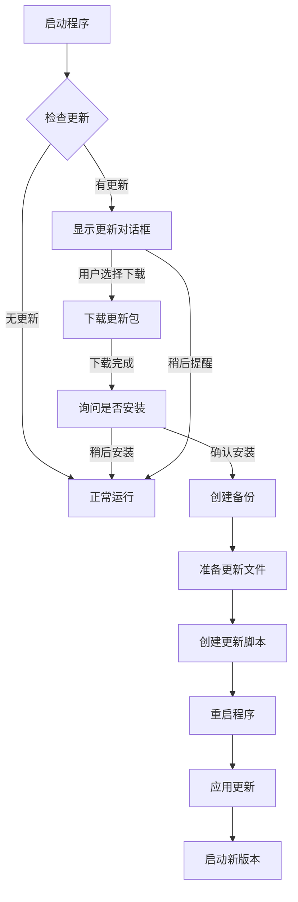

# 自动更新系统使用说明

## 功能特点

✨ **完整的更新解决方案**
- ✅ 自动检查更新（支持自定义服务器和 GitHub Releases）
- ✅ 并行下载更新包和资源文件
- ✅ 文件完整性校验（SHA256）
- ✅ 自动备份当前版本
- ✅ 更新失败自动回滚
- ✅ 友好的UI界面
- ✅ 支持增量更新
- ✅ 语义化版本管理

## 目录结构

```
update_system/
├── __init__.py              # 模块入口
├── update_config.py         # 配置管理
├── update_checker.py        # 更新检查
├── update_downloader.py     # 更新下载
├── update_installer.py      # 更新安装
├── update_ui.py            # UI界面
└── README.md               # 说明文档
```

## 快速开始

### 1. 在主程序中集成

```python
from update_system.update_ui import check_and_show_update

# 在程序启动时检查更新
class YourMainWindow(QMainWindow):
    def __init__(self):
        super().__init__()
        # ... 其他初始化代码 ...
        
        # 检查更新（可以放在菜单项中）
        self.check_update()
    
    def check_update(self):
        """检查更新"""
        check_and_show_update(self)
```

### 2. 添加菜单项

```python
# 在 main.py 中添加更新菜单
def init_menu(self):
    # 帮助菜单
    help_menu = self.menuBar().addMenu("帮助")
    
    # 检查更新
    update_action = QAction("检查更新", self)
    update_action.triggered.connect(self.check_for_updates)
    help_menu.addAction(update_action)

def check_for_updates(self):
    """检查更新"""
    from update_system.update_ui import check_and_show_update
    has_update = check_and_show_update(self)
    
    if not has_update:
        QMessageBox.information(
            self,
            "检查更新",
            "当前已是最新版本"
        )
```

## 配置说明

### update_config.json

```json
{
    "auto_check_update": true,
    "auto_download_update": false,
    "update_channel": "stable",
    "check_interval_hours": 24,
    "download_threads": 4,
    "enable_incremental_update": true,
    "backup_before_update": true
}
```

**配置项说明：**
- `auto_check_update`: 是否自动检查更新
- `auto_download_update`: 是否自动下载更新
- `update_channel`: 更新通道（stable/beta/dev）
- `check_interval_hours`: 检查更新的间隔（小时）
- `download_threads`: 下载线程数
- `enable_incremental_update`: 是否启用增量更新
- `backup_before_update`: 更新前是否备份

### version.json

```json
{
    "version": "1.0.0",
    "build_date": "2024-01-01",
    "description": "批量AI视频剪辑工具"
}
```

## 服务器端配置

### 方式1: 自定义服务器

在服务器上部署以下接口：

**获取更新清单**
```
GET /api/manifest.json
```

返回格式：
```json
{
    "version": "1.1.0",
    "build_date": "2024-01-15",
    "description": "版本更新说明",
    "changelog": [
        "新增功能A",
        "修复Bug B",
        "优化性能C"
    ],
    "download_url": "https://your-server.com/downloads/main_v1.1.0.exe",
    "file_size": 491560960,
    "checksum": "sha256-hash-value",
    "min_version": "1.0.0",
    "force_update": false,
    "resources": [
        {
            "name": "music_pack_v1.1.zip",
            "url": "https://your-server.com/resources/music_pack_v1.1.zip",
            "size": 85000000,
            "checksum": "sha256-hash-value",
            "type": "music"
        },
        {
            "name": "material_pack_v1.1.zip",
            "url": "https://your-server.com/resources/material_pack_v1.1.zip",
            "size": 120000000,
            "checksum": "sha256-hash-value",
            "type": "material"
        }
    ]
}
```

### 方式2: GitHub Releases

1. 在 GitHub 仓库中创建 Release
2. 上传以下文件：
   - `main.exe` - 主程序
   - `resources_music_v1.1.zip` - 音乐资源包
   - `resources_material_v1.1.zip` - 素材资源包

Release 描述示例：
```markdown
## 版本 v1.1.0

### 新增功能
- 新增功能A
- 新增功能B

### Bug修复
- 修复问题C
- 修复问题D

### 优化
- 性能优化E
```

## 资源包制作

### 创建资源更新包

```python
import zipfile
import os

def create_resource_pack(source_folder, output_zip):
    """创建资源包"""
    with zipfile.ZipFile(output_zip, 'w', zipfile.ZIP_DEFLATED) as zipf:
        for root, dirs, files in os.walk(source_folder):
            for file in files:
                file_path = os.path.join(root, file)
                arcname = os.path.relpath(file_path, source_folder)
                zipf.write(file_path, arcname)
    print(f"资源包已创建: {output_zip}")

# 创建音乐资源包
create_resource_pack('cacheMusic', 'resources_music_v1.1.zip')

# 创建素材资源包
create_resource_pack('material', 'resources_material_v1.1.zip')
```

### 计算文件校验和

```python
import hashlib

def calculate_sha256(file_path):
    """计算文件SHA256"""
    sha256_hash = hashlib.sha256()
    with open(file_path, "rb") as f:
        for byte_block in iter(lambda: f.read(4096), b""):
            sha256_hash.update(byte_block)
    return sha256_hash.hexdigest()

# 计算主程序校验和
checksum = calculate_sha256('main.exe')
print(f"SHA256: {checksum}")
```

## 打包发布流程

### 1. 更新版本号

修改 `update_config.py`:
```python
CURRENT_VERSION = "1.1.0"
```

### 2. 打包程序

```bash
pyinstaller main.spec
```

### 3. 准备资源包

```bash
python create_resource_pack.py
```

### 4. 计算校验和

```bash
python calculate_checksum.py
```

### 5. 上传文件

- 上传到自定义服务器或
- 创建 GitHub Release 并上传

### 6. 更新 manifest.json

更新服务器上的 manifest.json 文件

## 更新流程



## 注意事项

⚠️ **重要提示**

1. **备份机制**: 更新前会自动备份，保留最近3个版本
2. **更新失败回滚**: 如果更新失败，会自动从备份恢复
3. **资源文件**: 资源文件会完全替换，不支持增量更新
4. **配置文件**: 用户配置文件不会被覆盖
5. **网络要求**: 需要稳定的网络连接

## 故障排除

### 更新下载失败
- 检查网络连接
- 检查防火墙设置
- 尝试手动下载

### 更新安装失败
- 检查磁盘空间
- 检查文件权限
- 从备份恢复

### 版本回滚
```python
# 手动从备份恢复
from update_system.update_installer import UpdateInstaller
from update_system.update_config import UpdateConfig

config = UpdateConfig()
installer = UpdateInstaller(config)
installer._restore_from_backup()
```

## 高级功能

### 自定义更新检查

```python
from update_system.update_config import UpdateConfig
from update_system.update_checker import UpdateChecker

config = UpdateConfig()
checker = UpdateChecker(config)

# 强制检查更新
has_update, update_info = checker.check_for_updates(force=True)

if has_update:
    print(f"发现新版本: {update_info['version']}")
    print(checker.get_update_summary())
```

### 后台下载

```python
from update_system.update_downloader import UpdateDownloader

downloader = UpdateDownloader(config)

def progress_callback(downloaded, total, message):
    progress = int((downloaded / total) * 100) if total > 0 else 0
    print(f"下载进度: {progress}% - {message}")

downloader.download_update(update_info, progress_callback)
```

## 许可证

根据项目主许可证
